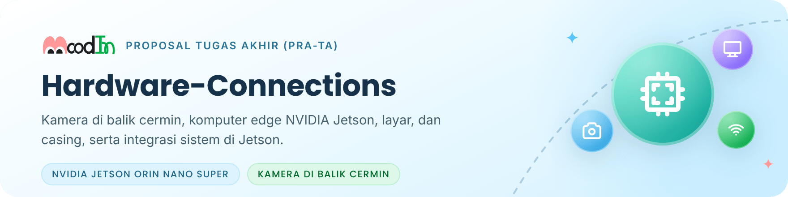
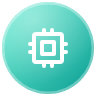

<picture>
  <source media="(prefers-color-scheme: dark)" srcset=".github/readme/banner-dark.png">
  
</picture>

<p align="center">
  <a href="#1-komponen-prototipe">Komponen</a> ·
  <a href="#2-menyalakan-kamera-csi-imx477-di-jetson">Kamera CSI</a> ·
  <a href="#3-struktur-repo">Struktur</a> ·
  <a href="#4-status-dokumen">Status dokumen</a> ·
  <a href="#5-pekerjaan-berikutnya-m2">Berikutnya</a>
</p>

Repositori ini berisi "tubuh" MoodIn: kamera yang tersembunyi di balik cermin dua arah, komputer _edge_ NVIDIA Jetson Orin Nano Super, layar, pencahayaan, casing, dan daya. Sejak tahap Pra-TA, repositori ini juga menampung **integrasi dan _deployment_ sistem di Jetson**, yaitu skrip pemasangan, layanan, dan diagnosis yang menghubungkan perangkat keras dengan model.

Repositori ini bagian dari proyek [MoodIn](https://github.com/MoodInBME/MoodIn-master), yang saat ini dikembangkan sebagai Proposal Tugas Akhir (Pra-TA). Model ada di [Software-Architecture](https://github.com/MoodInBME/Software-Architecture), dan antarmuka di [Interface-App](https://github.com/MoodInBME/Interface-App).

<p>
  
  
  
  
</p>

> [!NOTE]
> **Status (28 Okt 2026):** dokumen di repositori ini masih versi era GEMASTIK, sama dengan tag [`gemastik-xix-2026`](https://github.com/MoodInBME/Hardware-Connections/tree/gemastik-xix-2026). Beberapa komponen akan berubah mengikuti bimbingan. Tabel di bawah menandai mana yang tetap dan mana yang menunggu keputusan.

## 1. Komponen prototipe

Prototipe era GEMASTIK sudah memiliki seluruh rantai perangkat keras, dari kamera sampai layar. Pada tahap Pra-TA, sebagian komponen ditinjau ulang supaya kualitas sinyal wajah dan kenyamanan pengguna lebih baik.

<table>
  <tr>
    <th width="56"></th>
    <th align="left">Komponen</th>
    <th align="left">Prototipe saat ini</th>
    <th align="left">Status tahap Pra-TA</th>
  </tr>
  <tr>
    <td align="center"></td>
    <td><b>Komputer edge</b></td>
    <td>NVIDIA Jetson Orin Nano Super 8 GB, Ubuntu 24.04, JetPack 7.2</td>
    <td>Tetap</td>
  </tr>
  <tr>
    <td align="center"></td>
    <td><b>Kamera</b></td>
    <td>Arducam IMX477 (RGB, filter IR-cut tetap) dengan lensa M12 55°</td>
    <td>Opsi modul dengan IR-cut bermotor menunggu bimbingan</td>
  </tr>
  <tr>
    <td align="center"></td>
    <td><b>Layar</b></td>
    <td>Waveshare 10,1" 1024×600</td>
    <td>Akan diganti dengan layar yang lebih besar</td>
  </tr>
  <tr>
    <td align="center"></td>
    <td><b>Cermin dan pencahayaan</b></td>
    <td>Cermin dua arah di depan kamera dan layar</td>
    <td>Susunan dan sumber cahaya menunggu bimbingan</td>
  </tr>
  <tr>
    <td align="center"></td>
    <td><b>Casing</b></td>
    <td>Cetak 3D, desain era GEMASTIK</td>
    <td>Disesuaikan setelah layar dan kamera final</td>
  </tr>
  <tr>
    <td align="center"></td>
    <td><b>Jaringan</b></td>
    <td>MQTT di jaringan lokal</td>
    <td>Tanpa TLS; <i>username/password</i> broker dan enkripsi isi pesan</td>
  </tr>
</table>

Angka daya, termal, dan FoV di dokumen era GEMASTIK perlu diukur atau dihitung ulang setelah komponen final.

## 2. Menyalakan kamera CSI (IMX477 di Jetson)

Kamera IMX477 di Jetson Orin Nano Super memakai kabel CSI dengan adapter **15-pin ke 22-pin**. Error **`-121`** biasanya menandakan masalah kabel: terbalik, tidak terkunci, atau terlalu panjang.

Urutan diagnosis:

1. `ls /dev/video*`
2. `dmesg | grep -i imx477`
3. `v4l2-ctl --list-devices`, lalu `v4l2-ctl --list-formats-ext`
4. Ambil satu _frame_ dengan `nvarguscamerasrc` (GStreamer) atau libargus. Jangan lanjut ke pemrosesan wajah sebelum tahap ini lulus.

## 3. Struktur repo

```text
Hardware-Connections/
├── bom/                  daftar komponen dan harga (era GEMASTIK)
├── camera-module/        lensa, FoV, konfigurasi IMX477, uji atenuasi cermin
├── display/              pemasangan layar Waveshare (era GEMASTIK)
├── enclosure/            CAD (STP), STL, berkas cetak, pengaturan cetak
├── network/              jaringan dan MQTT
├── power/                anggaran dan log pengukuran daya
├── schematics/           distribusi daya
├── assembly-guide.md     urutan perakitan
└── troubleshooting.md    diagnosis masalah umum
```

Folder `jetson/` untuk skrip integrasi dan _deployment_ ditambahkan setelah skrip diagnosis dipindah dari Software-Architecture.

## 4. Status dokumen

| Dokumen                                                          | Status                                                                        |
| ---------------------------------------------------------------- | ----------------------------------------------------------------------------- |
| `camera-module/fov-calculation.md`, `lens-m12-selection.md`      | Berlaku untuk lensa M12 55°; hitung ulang bila lensa atau jarak kerja berubah |
| `camera-module/imx477-jetson-config.md`, `troubleshooting.md`    | Berlaku sebagian; dirapikan di M2                                             |
| `camera-module/mirror-attenuation-tests.md`                      | Log uji era GEMASTIK; diulang setelah susunan cermin final                    |
| `display/waveshare-10.1-setup.md`                                | Era GEMASTIK; layar akan diganti                                              |
| `bom/full-bom.csv`, `power/`, `schematics/`, `assembly-guide.md` | Era GEMASTIK; diperbarui setelah komponen final (M2)                          |
| `enclosure/`                                                     | Desain era GEMASTIK; direvisi mengikuti layar dan kamera baru                 |
| `network/mqtt-tls-config.md`                                     | **Arsip.** Tahap Pra-TA tidak memakai TLS                                     |
| `network/mqtt-topic-schema.md`                                   | **Arsip.** Mengacu kontrak v1.0.0; kontrak pesan v2 menyusul di MoodIn-master |
| `network/wifi-provisioning.md`                                   | Ditinjau di M2                                                                |

## 5. Pekerjaan berikutnya (M2)

- [ ] Keputusan bimbingan: kamera, layar pengganti, susunan cermin, dan pencahayaan.
- [ ] Uji kamera di Jetson dengan susunan cermin yang baru.
- [ ] Skrip diagnosis Jetson dipindah dari Software-Architecture ke folder `jetson/` di repo ini.
- [ ] BOM, daya, dan termal diperbarui setelah komponen final.

## Lisensi

Belum ditetapkan; menunggu keputusan bersama calon dosen pembimbing. Tanpa berkas `LICENSE`, isi repo ini tidak dilisensikan untuk dipakai ulang.

---

<div align="center">
<sub>
Departemen Teknik Biomedik · Fakultas Teknologi Elektro dan Informatika Cerdas (FTEIC)<br>
Institut Teknologi Sepuluh Nopember · Surabaya, Indonesia
</sub>
<br><br>
<sub>Ikon antarmuka: <a href="https://tabler.io/icons">Tabler Icons</a> (MIT), lihat <a href=".github/readme/KREDIT.md">kredit aset</a>.</sub>
</div>
